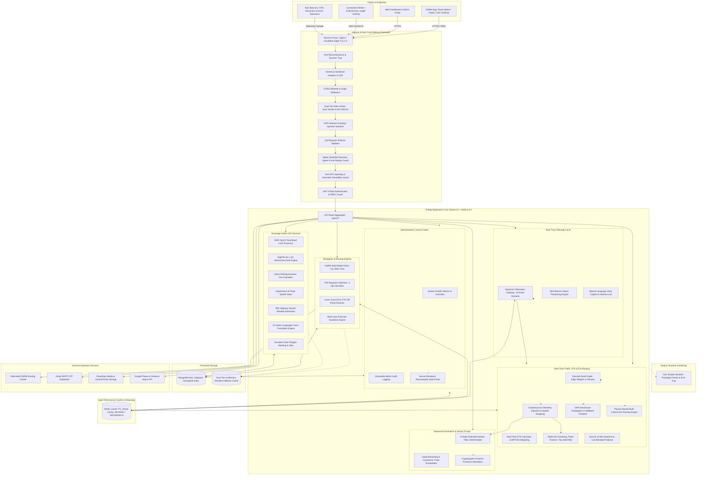
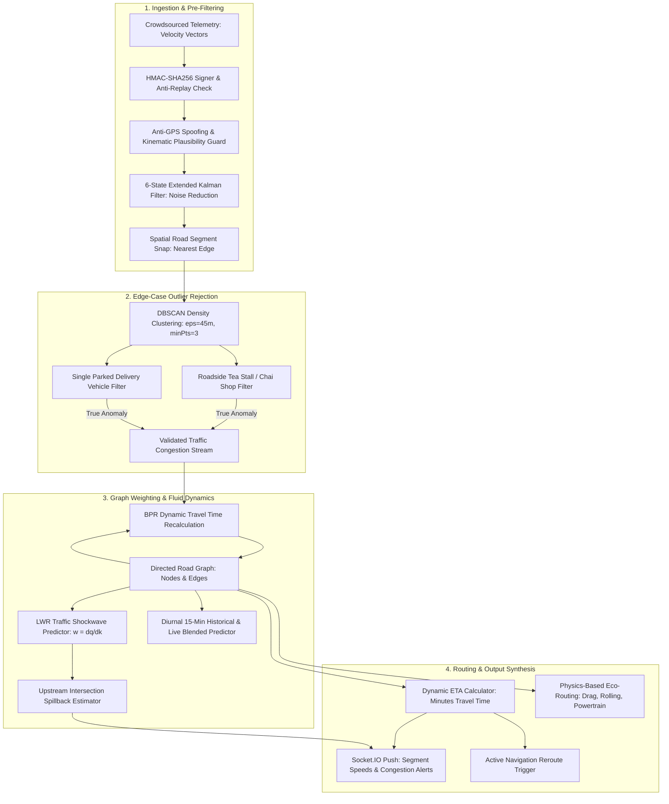
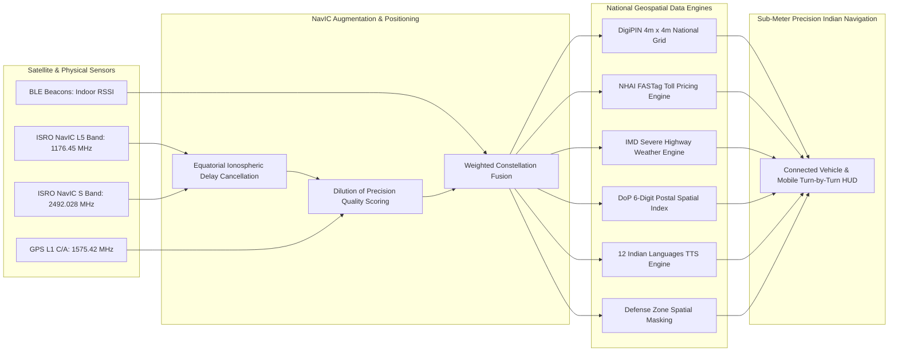
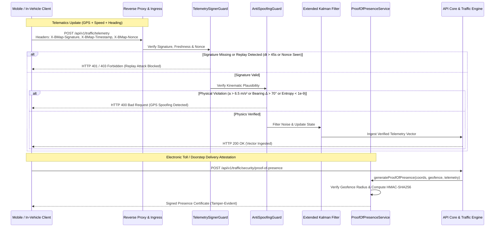
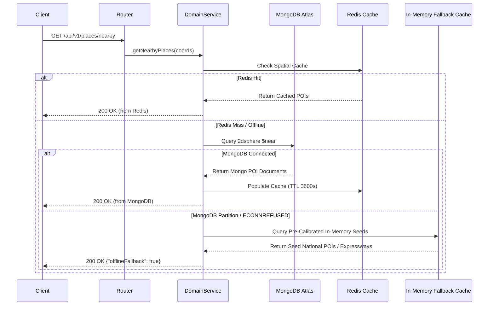
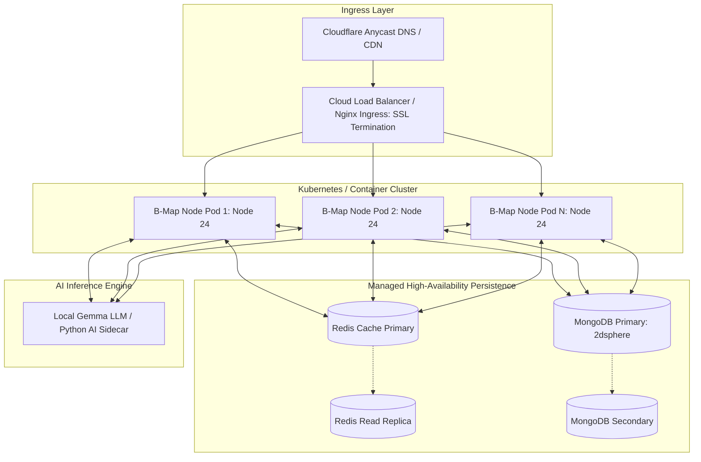
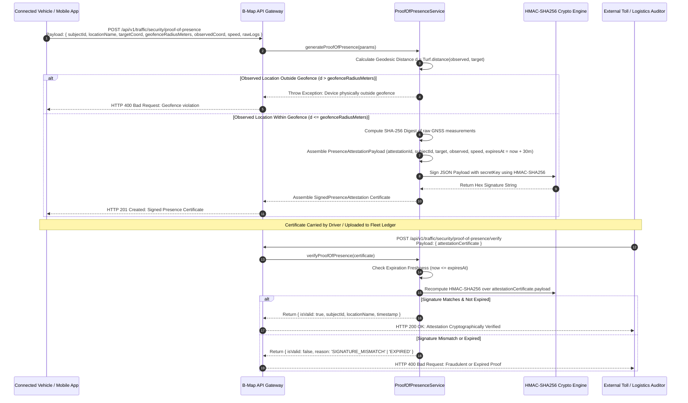
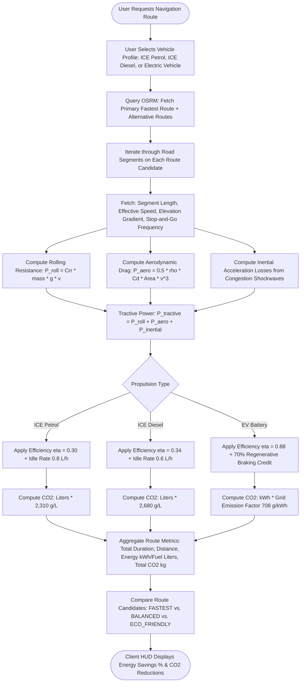
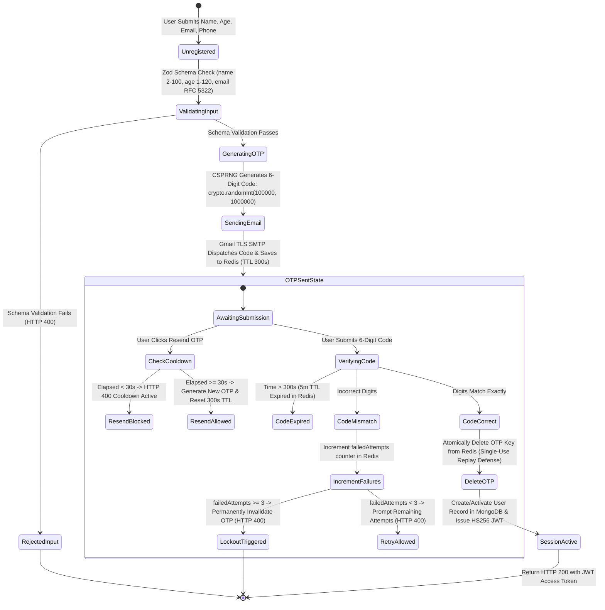

# 🏛️ B-Map Platform Architecture Specification

> **Sovereign Indian Geospatial, Turn-by-Turn Navigation, Real-Time Traffic & Telematics Engine**  
> *Version:* 2.0.0 | *Runtime:* Node.js 24 + TypeScript | *Revision:* Enterprise Production-Ready

---

## 1. Architectural Philosophy & Overview

**B-Map** is an enterprise-grade geospatial, real-time navigation, traffic flow estimation, and telematics platform engineered specifically for the Indian subcontinent while maintaining universal global GIS interoperability. The platform integrates sovereign Indian positioning and address infrastructure (ISRO NavIC, DigiPIN, NHAI FASTag, Postal Pincodes, IMD Weather) with cutting-edge real-time graph routing, physics-based eco-telematics, Macroscopic Lighthill-Whitham-Richards (LWR) traffic shockwave dynamics, and zero-trust telematics defenses.

### Foundational Principles:
1. **Decoupled Modularity**: Over 45 discrete domain modules operate independently behind a unified Express router, enforcing clean domain separation, high testability, and isolated service lifecycles.
2. **Sub-Millisecond Geospatial Caching**: High-frequency spatial queries (turn-by-turn routes, driver tracking, nearby POIs) leverage Redis in-memory caches, `GEOADD`, and `GEOSEARCH` primitives before querying persistent document stores.
3. **Sovereign Indian Geospatial Stack**: Native first-class integration with ISRO NavIC dual-frequency L5/S-band satellite positioning, 4m×4m DigiPIN hierarchical addressing, 6-digit Postal Pincodes, NHAI FASTag electronic toll pricing, and IMD Highway Weather advisories.
4. **Dynamic Road Network Graph & Real-Time Traffic**: Directed road network graph where edges are strictly weighted in **Travel Time Minutes** (not static distance), continuously recalculated using the Bureau of Public Roads (BPR) formulation, real-time crowdsourced telematics, and DBSCAN false-positive anomaly filtering.
5. **Macroscopic Traffic Shockwave & Spillback Analysis**: LWR traffic flow model calculating shockwave velocities ($w = \Delta q / \Delta k$) to predict queue spillbacks to upstream intersections before gridlock occurs.
6. **Advanced Kinematics & Sensor Fusion**: 6-state Extended Kalman Filter (EKF) with Continuous-Time White Noise Acceleration (CWNA) motion modeling, dead reckoning extrapolation, and Doppler-concordance anti-spoofing.
7. **Zero-Trust Security & Anti-Fraud Perimeter**: End-to-end cryptographic telemetry request signing with 45s replay protection, Anti-GPS Spoofing, physical Proof-of-Presence geofence attestation, and runtime anti-tamper prototype freezing.
8. **Dual-Tier Offline Resilience**: Zero-downtime architecture providing calibrated in-memory fallback stores when MongoDB or Redis experience transient network partitions or failover events.
9. **Low-Latency Bidirectional Streaming**: Socket.IO-driven real-time navigation progress, driver breadcrumb streaming, HUD visual telemetry, and instant sub-second off-route reroute geometry dispatch.

---

## 2. High-Level System Architecture Diagram



---

## 3. Layered Architectural Breakdown

### 3.1 Client Tier
The client tier communicates across heterogeneous mobile, automotive, web, and IoT channels:
- **Mobile Native Applications (iOS / Android)**: Built with React Native or Flutter, utilizing REST APIs for initialization, metadata, and authentication, and persistent Socket.IO channels for continuous turn-by-turn guidance and crowdsourced telemetry.
- **In-Vehicle Infotainment (IVI) & Connected HUD**: Android Automotive OS, Apple CarPlay, and vehicle CAN-bus/OBD interfaces transmitting telemetry and receiving lane-level maneuvers, speed camera alerts, and dynamic shockwave advisories.
- **Micro-Mobility & Two-Wheeler Riders**: Specialized `rider-mode` consuming lean angle dynamics, pothole warnings, flyover entry restrictions, and narrow-lane bypass routes.
- **Web & Administrative Operations Center**: Responsive server-rendered glassmorphic single-page experience served from `/admin/dashboard` for live system monitoring, traffic overrides, and user management.
- **IoT & Bluetooth Beacons (BLE)**: Hardware beacons positioned in multistory parking facilities, transit terminals, and indoor venues broadcasting UUID, Major, and Minor packets for sub-meter trilateration.

### 3.2 Ingress & Zero-Trust Security Perimeter Tier
Inbound requests pass through strict defence-in-depth security layers:
1. **Reverse Proxy & TLS Termination**: Enforces TLS 1.3, strict cipher suites, Brotli compression, and proxy IP resolution (`X-Forwarded-For`).
2. **Anti-Reconnaissance Trap (`antiReconTrap`)**: Automatically detects and drops automated vulnerability scanners and malicious probes targeting sensitive paths (`.env`, `wp-admin`, `phpmyadmin`, `.git`).
3. **HTTP Header Hardening (`helmet`)**: Strips `X-Powered-By`, sets `Server: Protected-Gateway`, injects Content-Security-Policy (CSP), HSTS (`max-age=31536000; includeSubDomains; preload`), `X-Frame-Options: DENY`, and `X-Content-Type-Options: nosniff`.
4. **CORS Whitelist & Origin Reflection**: Dynamically validates origins against `CORS_ORIGIN`, asserting RFC compliant CORS headers with credentials support.
5. **Dual-Tier Sliding Window Rate Limiting**:
   - `authRateLimiter`: Restricts `/api/v1/auth/*` to **15 requests per 15 minutes** per IP to thwart credential stuffing and SMTP abuse.
   - `apiRateLimiter`: Restricts general API queries to **300 requests per minute** per client.
6. **NoSQL Operator & Query Injection Sanitizer (`noSqlSanitizer`)**: Recursively sanitizes request keys, stripping `$` prefix operators and dot notation to neutralize MongoDB query manipulation.
7. **HTTP Parameter Pollution (HPP) Defense**: Standardizes array-duplicated query parameters to prevent parameter pollution.
8. **Request Body Memory Guard**: Enforces strict **1MB** body parser limits (`express.json({ limit: '1mb' })`) to prevent memory exhaustion DoS.
9. **Zero-Trust Telemetry Request Signer (`TelemetrySignerGuard`)**: Verifies HMAC-SHA256 signatures (`X-BMap-Signature`), epoch freshness (`X-BMap-Timestamp`), and cryptographic nonces (`X-BMap-Nonce`) within a **45-second sliding replay window**.
10. **Anti-GPS Spoofing Guard (`AntiSpoofingGuard`)**: Evaluates kinematics, physics bounds, acceleration ($a \le 6.5 \text{ m/s}^2$), top velocity ($v \le 220 \text{ km/h}$), bearing concordance ($\Delta \theta \le 70^\circ$), and spatial micro-entropy ($\ge 10^{-9}$).
11. **JWT HS256 Authenticator & RBAC Guard**: Pinned algorithm authentication with role-based authorization across `anonymous`, `user`, and `admin` tiers.

### 3.3 Node.js Runtime Hardening (`AntiTamperSentinel`)
To prevent in-memory tampering and reverse engineering:
- **Deep Prototype Freezing**: Freezes `Object`, `Array`, `Function`, `String`, `Number`, `Boolean`, `Symbol`, `Promise`, `Map`, and `Set` prototypes to prevent prototype pollution gadget chains.
- **Dynamic Code Execution Lockdown**: Disables `eval()` and indirect `Function` evaluation.
- **Runtime Environment Immutability**: Freezes environment configuration objects.
- **Debugger & Inspector Traps**: Detects attached V8 inspector debuggers and terminates unauthorized inspection sessions.

### 3.4 Application Core & Domain Tier
The backend adopts a decoupled modular architecture organized into 45+ discrete domains under `src/modules/`:

| Module Directory | Domain Focus & Core Responsibilities |
| :--- | :--- |
| `admin/` | Server-rendered glassmorphic dashboard, dynamic system config, audit logs, traffic/weather overrides |
| `ai-copilot/` | Natural Language Voice Navigation, Gemma LLM integration, speech intent classification |
| `ai-data-mining/` | Spatial pattern mining, congestion prediction, trip profiling, mobility telemetry |
| `ar-walk-cycle/` | Augmented Reality walking, camera pose telemetry, pedestrian micromobility guidance |
| `auth/` | Registration, passwordless email OTP authentication, JWT token issuance |
| `automotive/` | Automotive HUD telemetry, CAN-bus stream ingestion, cockpit sync, ADAS collision alerts |
| `boundaries/` | GeoJSON boundary queries for Indian states, districts, taluks, and municipal wards |
| `car-navigation/` | Multi-alternative automotive routing, highway lane assist, speed camera alerts |
| `digipin/` | Government of India / Department of Posts 4m×4m hierarchical alphanumeric grid engine |
| `emergency/` | SOS distress dispatch, nearest hospital/police radial routing, emergency responder coordination |
| `environment/` | Real-time Air Quality Index (AQI), low-emission zones, green navigation corridors |
| `evcharging/` | EV charging station directory, connector compatibility (Type-2, CCS-2, GB/T), range planning |
| `fares/` | Auto-rickshaw, taxi, ride-hailing, and metro fare estimation matrices |
| `fleet/` | Multi-vehicle telematics, geofence boundary monitoring, asset tracking |
| `hazards/` | Crowdsourced and official road hazard reporting (potholes, waterlogging, accidents) |
| `health/` | System uptime, process memory metrics, MongoDB/Redis connectivity health probes |
| `lane-routing/` | High-definition lane-level maneuvers, highway exit positioning, lane drift warnings |
| `location-access/` | GPS telemetry ingestion, batch location uploading, raw trace storage |
| `maps-tiles/` | Vector and raster map tile proxying, caching, MapLibre GL compatible tile server |
| `motion-fitness/` | Accelerometer activity classification (automotive, walking, cycling, stationary) |
| `navic/` | ISRO NavIC L5/S-band dual-frequency signal processing & ionospheric delay correction |
| `navigation/` | Active navigation session engine, cross-track error (XTD) monitoring, instant rerouting |
| `nearby-devices/` | Bluetooth Low Energy (BLE) beacon indoor trilateration & venue mapping |
| `notifications/` | Push notifications, geofence boundary alerts, trip summary notifications |
| `obfuscation/` | Sensitive defense and military zone polygon spatial masking and random coordinate jitter |
| `parking/` | Multilevel indoor parking guidance, bay occupancy detection, parking gate navigation |
| `pincode/` | Indian 6-digit postal code spatial search, autocomplete, and polygon geocoding |
| `places/` | Points of Interest (POIs), categories, MongoDB `$near` geospatial queries |
| `positioning/` | Multi-sensor positioning, dead reckoning, sensor fusion, weak-signal interpolation |
| `public-transit/` | Metro networks (Delhi, Bengaluru, Mumbai), bus timetables, multimodal transit routing |
| `ratings/` | Place reviews, road quality crowdsourced ratings, driving comfort feedback |
| `rider-mode/` | Two-wheeler navigation (lean angle tracking, narrow lanes, flyover restrictions) |
| `roads/` | National Highways (NH), Expressways, state highways, road quality classification |
| `routes/` | OSRM route directions, TSP multi-stop trip optimization, GPS map matching |
| `spatial-visualization/`| 3D terrain meshes, building footprints, traffic congestion heatmaps |
| `sr-navigation/` | Spatial Reality mixed-reality navigation HUD, lane drift and collision warning |
| `super-app/` | Ride hailing, lifestyle bookings, roadside dining, EV charging, unified commerce |
| `timezone/` | Indian Standard Time (IST) geospatial timezone mapping and solar calculations |
| `tolls/` | NHAI FASTag electronic toll plazas, vehicle class rates, cashless lane guidance |
| `tracking/` | Real-time driver location tracking, Redis `GEOADD` and `GEOSEARCH` proximity queries |
| `traffic/` | Directed road graph (edges weighted in minutes), real-time ETA, LWR shockwaves, eco-routing |
| `unified-engine/` | Orchestrated multimodal route synthesis combining transit, walking, and driving |
| `v2x/` | Vehicle-to-Everything (V2X) hazard broadcasting, emergency vehicle priority alerts |
| `vernacular/` | 12 Indian regional language voice direction localization and text-to-speech translation |
| `weather/` | IMD highway weather advisories, monsoon flooding, northern winter fog alerts |

---

## 4. Real-Time Traffic & Dynamic ETA Engine Architecture



### 4.1 Directed Road Graph Network
- **Topology**: Intersections represent **Nodes** (`IntersectionNode`), connected by directed **Edges** (`RoadSegmentEdge`).
- **Edge Weight Invariance**: Edge weights are **STRICTLY CALCULATED AND STORED IN TRAVEL TIME MINUTES**, never static distance:
  $$W_{minutes} = \frac{L_{km}}{V_{effective}} \times 60$$
- **BPR Dynamic Congestion Re-Weighting**: When traffic density rises, travel time scales according to the Bureau of Public Roads (BPR) function:
  $$T = T_{free} \times \left(1 + \alpha \cdot \left(\frac{V}{C}\right)^\beta\right)$$
  Where calibrated Indian subcontinental constants are $\alpha = 0.65$ and $\beta = 2.0$.

### 4.2 DBSCAN Congestion Anomaly Clustering
To eliminate false-positive slowdowns (e.g. motorcycles stopped at a roadside tea stall, single parked delivery vans, or pedestrians carrying smartphones):
- **Epsilon Distance ($\varepsilon$)**: $45 \text{ meters}$.
- **Minimum Cluster Points ($minPts$)**: $3 \text{ devices}$.
- **Speed Gating**: Speed $< 15 \text{ km/h}$.
- **Rejection Rule**: If a stopped vehicle lacks cluster support from $\ge 3$ nearby moving devices, it is rejected as a localized non-traffic anomaly and excluded from road segment speed degradation.

### 4.3 Macroscopic LWR Traffic Shockwave Dynamics
Implements the continuous Lighthill-Whitham-Richards (LWR) conservation model:
$$\frac{\partial q}{\partial x} + \frac{\partial k}{\partial t} = 0$$
- **Greenshields Fundamental Flow Relationship**:
  $$v = v_{free} \cdot \left(1 - \frac{k}{k_{jam}}\right) \implies k = k_{jam} \cdot \left(1 - \frac{v}{v_{free}}\right)$$
- **Shockwave Boundary Velocity ($w$)**:
  $$w = \frac{q_2 - q_1}{k_2 - k_1} \text{ (km/h)}$$
  - If $w < 0$: The congestion queue is propagating **backward upstream**.
  - If $w > 0$: The bottleneck has cleared and a **forward recovery wave** is dissipating the queue.
- **Spillback Time to Upstream Intersection**:
  $$t_{spillback} = \frac{D_{upstream}}{|w|} \times 60 \text{ minutes}$$
  Alerts connected navigation sessions to reroute before the upstream junction is blocked.

### 4.4 Physics-Based Eco-Routing Engine
Calculates true instantaneous tractive energy consumption across three primary physical resistances:
1. **Rolling Resistance**: $P_{roll} = C_{rr} \cdot m \cdot g \cdot v$
2. **Aerodynamic Drag**: $P_{aero} = \frac{1}{2} \cdot \rho_{air} \cdot C_d \cdot A \cdot v^3$
3. **Inertial Losses**: Acceleration losses and stop-and-go congestion penalties.
- **Powertrain Efficiencies**:
  - Petrol ICE: $\eta = 0.30$ (Idle fuel rate: $0.8 \text{ L/h}$)
  - Diesel ICE: $\eta = 0.34$ (Idle fuel rate: $0.6 \text{ L/h}$)
  - Electric Vehicle (EV): $\eta = 0.88$ with regenerative braking credit ($70\%$ recovery of kinetic braking energy).

---

## 5. Sovereign Indian Navigation & Geospatial Infrastructure



### Sovereign Capabilities:
1. **ISRO NavIC Dual-Frequency Processing**: Ingests L5 and S-band carrier frequencies to completely cancel out equatorial ionospheric delays, delivering sub-meter horizontal accuracy across India and neighboring territories up to 1,500 km.
2. **DigiPIN Hierarchical Grid**: Encodes any Indian coordinate into a 10-character alphanumeric digital address accurate to a **4m×4m cell** using characters `2-9` and letters excluding easily confused glyphs (`0, 1, O, I`).
3. **National FASTag Toll Database**: Computes real-time toll charges for National Expressways (e.g. Delhi-Mumbai NE-4, Yamuna Expressway, Eastern Peripheral, Bengaluru-Mysuru Expressway) segmented across vehicle classes (Class 4 through Class 9).
4. **IMD Severe Weather Integration**: Continuously monitors highway weather warnings (`GREEN`, `YELLOW`, `ORANGE`, `RED`), alerting drivers of northern winter fog (visibility $< 50\text{m}$) and monsoon waterlogging.
5. **Defense Area Polygon Obfuscation**: In compliance with national mapping directives, applies spatial jitter ($200\text{m}-500\text{m}$) and masks sensitive military and strategic installation boundaries.
6. **Vernacular Multi-Lingual Guidance**: Audio-ready localized directions translated across 12 scheduled Indian languages: Hindi (`hi`), Tamil (`ta`), Telugu (`te`), Bengali (`bn`), Marathi (`mr`), Gujarati (`gu`), Kannada (`kn`), Malayalam (`ml`), Punjabi (`pa`), Odia (`or`), Assamese (`as`), and English (`en`).

---

## 6. Advanced Mathematical & Sensor Fusion Layer

### 6.1 Extended Kalman Filter (EKF) Kinematic Motion Model
To smooth noisy GPS fixes, survive urban canyons, and extrapolate positions in road tunnels:
- **State Vector ($6 \times 1$)**:
  $$\mathbf{x} = \begin{bmatrix} x & y & v_x & v_y & a_x & a_y \end{bmatrix}^T$$
- **Continuous-Time White Noise Acceleration (CWNA) State Transition Matrix ($\mathbf{F}$)**:
  $$\mathbf{F}(\Delta t) = \begin{bmatrix}
  1 & 0 & \Delta t & 0 & \frac{1}{2}\Delta t^2 & 0 \\
  0 & 1 & 0 & \Delta t & 0 & \frac{1}{2}\Delta t^2 \\
  0 & 0 & 1 & 0 & \Delta t & 0 \\
  0 & 0 & 0 & 1 & 0 & \Delta t \\
  0 & 0 & 0 & 0 & 1 & 0 \\
  0 & 0 & 0 & 0 & 0 & 1
  \end{bmatrix}$$
- **Process Noise Covariance ($\mathbf{Q}$)**:
  $$\mathbf{Q} = q_{accel} \cdot \begin{bmatrix}
  \frac{\Delta t^4}{4}\mathbf{I}_2 & \frac{\Delta t^3}{2}\mathbf{I}_2 & \frac{\Delta t^2}{2}\mathbf{I}_2 \\
  \frac{\Delta t^3}{2}\mathbf{I}_2 & \Delta t^2\mathbf{I}_2 & \Delta t\mathbf{I}_2 \\
  \frac{\Delta t^2}{2}\mathbf{I}_2 & \Delta t\mathbf{I}_2 & \mathbf{I}_2
  \end{bmatrix}$$
- **Measurement Update ($\mathbf{z} = [x, y, v_x, v_y]^T$)**:
  $$\mathbf{K} = \mathbf{P}^- \mathbf{H}^T (\mathbf{H} \mathbf{P}^- \mathbf{H}^T + \mathbf{R})^{-1}$$
  $$\mathbf{x} = \mathbf{x}^- + \mathbf{K} (\mathbf{z} - \mathbf{H} \mathbf{x}^-)$$
  $$\mathbf{P} = (\mathbf{I} - \mathbf{K} \mathbf{H}) \mathbf{P}^-$$
- **Dead Reckoning Extrapolation**: When satellite signal is lost in tunnels, the EKF performs pure inertial dead reckoning by projecting state $\mathbf{x}_{k+1} = \mathbf{F} \mathbf{x}_k$ while tracking covariance uncertainty trace $\text{Tr}(\mathbf{P})$. Extrapolation is bounded to a maximum of 10 seconds.

### 6.2 Haversine Great-Circle Distance & Cross-Track Error (XTD)
- **Haversine Distance**: Computes geodesic separation between coordinates assuming mean Earth radius $R = 6,371,000 \text{ m}$.
- **Cross-Track Error (XTD)**:
  $$\text{XTD} = \arcsin\left(\sin\left(\frac{d_{13}}{R}\right) \cdot \sin(\theta_{13} - \theta_{12})\right) \cdot R$$
  Where $d_{13}$ is the distance from line origin to vehicle, $\theta_{13}$ is bearing to vehicle, and $\theta_{12}$ is route leg bearing.
- **Off-Route Threshold**: Triggered when $\text{XTD} > 40 \text{ meters}$, initiating automatic OSRM recalculation with a 5-second anti-jitter cooldown.

---

## 7. Zero-Trust Security & Anti-Fraud Architecture



### Security Guard Specifications:
1. **Telemetry Request Signer (`TelemetrySignerGuard`)**:
   - `X-BMap-Signature`: Hex-encoded $\text{HMAC-SHA256}(SecretKey, \text{Timestamp} + ":" + \text{Nonce} + ":" + \text{Payload})$.
   - `X-BMap-Timestamp`: Epoch milliseconds; rejected if $|T_{server} - T_{client}| > 45,000 \text{ ms}$.
   - `X-BMap-Nonce`: 16+ byte unique token checked against in-memory sliding cache to neutralize replay attacks.
2. **Anti-GPS Spoofing Guard (`AntiSpoofingGuard`)**:
   - **Acceleration Cap**: $a_{max} = 6.5 \text{ m/s}^2$ ($\approx 0.66g$, maximum civilian road acceleration).
   - **Velocity Cap**: $v_{max} = 220 \text{ km/h}$.
   - **Bearing Concordance**: Maximum permissible deviation between displacement vector and gyro heading is $\le 70^\circ$.
   - **Spatial Micro-Entropy**: Evaluates coordinate variance ($\sigma^2 \ge 10^{-9}$); synthetic emulator coordinates with zero GPS jitter are flagged and rejected.
3. **Cryptographic Proof-of-Presence (`ProofOfPresenceService`)**:
   - Issues tamper-evident, cryptographically signed presence certificates asserting physical device presence within a verified geofence boundary at an exact epoch timestamp.
   - Includes raw GNSS breadcrumb SHA-256 hash, observed speed, confidence score, and expiration window.
   - Used for ticketless highway tolling, insurance telematics, and e-commerce delivery verification.

---

## 8. Dual-Tier Offline Resilience & In-Memory Fallback



To guarantee uninterrupted navigation during catastrophic network partitions or cloud database failovers:
- **Resilient Fallback Stores**: Every critical service maintains an in-memory seed catalog of major Indian National Expressways, key transport junctions, and essential POIs.
- **Fail-Safe Exception Isolation**: Database exceptions (`ECONNREFUSED`, `MongooseServerSelectionError`) are caught gracefully; services automatically fulfill requests from the fallback tier while flagging `"offlineFallback": true` in response headers.

---

## 9. Real-Time WebSocket & Socket.IO Topology

The real-time layer operates over persistent WebSocket channels structured into 10 specialized event namespaces:

```
Socket.IO Gateway (/socket.io)
├── 1. Tracking: location:update, location:broadcast, location:subscribe
├── 2. Navigation: nav:join, nav:update_progress, nav:off_route_alert, nav:reroute_success
├── 3. Weak-Signal Positioning: positioning:telemetry, positioning:fused_state
├── 4. Lane Guidance: lane:guidance_stream, lane:guidance_broadcast, veteran:hazard_alert
├── 5. SR Mixed Reality HUD: sr:telemetry_stream, sr:hud_broadcast, sr:collision_warning
├── 6. Automotive CAN & IVI: auto:can_stream, auto:cockpit_sync, auto:eco_score_broadcast
├── 7. Rider Mode Two-Wheeler: rider:dynamics_stream, rider:lean_broadcast, rider:crash_alert
├── 8. Parking Space-Level: parking:entrance_detect, parking:indoor_guidance, parking:bay_status
├── 9. AI Voice Copilot: copilot:message_stream, copilot:processing_status, copilot:message_response
└── 10. Real-Time Traffic & Shockwave: traffic:telemetry_stream, traffic:segment_update, traffic:eta_update, traffic:anomaly_filtered
```

- **Room Scoping**: Active navigation sessions join room `nav:<sessionId>`; driver tracking binds to `driver:<driverId>`; traffic segments broadcast to `segment:<segmentId>`.
- **Clustered Scalability**: Compatible with `@socket.io/redis-adapter` for horizontal scaling across multiple Node.js Kubernetes worker pods.

---

## 10. Deployment & Scalability Topology




- **Stateless Node Containers**: Node.js instances are fully stateless, enabling autoscaling via Kubernetes Horizontal Pod Autoscaler (HPA) based on CPU and request latency metrics.
- **Health Probing**: Kubernetes `livenessProbe` and `readinessProbe` target `/api/v1/health` with a sub-50ms target response threshold.
- **Zero-Downtime Rolling Deploys**: Pod lifecycle hooks honor graceful shutdown signals (`SIGTERM`, `SIGINT`), completing active socket transmissions and draining database connection pools before process termination.

---

## 11. End-to-End Operational Flowcharts & State Automata

### 11.1 Real-Time Telematics Ingestion, Anti-Spoofing, EKF & Traffic Re-Weighting Flowchart

This flowchart details the complete lifecycle of a velocity vector from raw vehicle transmission through cryptographic verification, kinematic physics checks, 6-state Kalman filtering, spatial road segment snapping, DBSCAN tea-stall outlier rejection, BPR dynamic edge weight updates (in travel time minutes), and real-time Socket.IO broadcasting.

```mermaid
flowchart TD
    Start([Vehicle / Mobile Streams Telemetry]) --> CapturePayload[Capture: lon, lat, speedKmh, headingDeg, accuracy, timestamp]
    CapturePayload --> AddHeaders[Inject Headers: X-BMap-Signature, X-BMap-Timestamp, X-BMap-Nonce]
    AddHeaders --> Transmit[POST /api/v1/traffic/telemetry or Socket.IO 'traffic:telemetry_stream']

    Transmit --> Ingress[Ingress Security Gateway & Anti-Recon Trap]
    Ingress --> RateLimit{Rate Limit Check: apiRateLimiter 300/1m}
    RateLimit -->|Exceeded| Drop429[Return HTTP 429 Too Many Requests]
    RateLimit -->|Pass| VerifySigner{TelemetrySignerGuard: Verify HMAC-SHA256}

    VerifySigner -->|Bad Signature| Drop401[Return HTTP 401 Unauthorized]
    VerifySigner -->|Freshness dt > 45s| DropExpired[Return HTTP 401 Stale Timestamp Error]
    VerifySigner -->|Nonce Seen| DropReplay[Return HTTP 403 Nonce Replay Detected]
    VerifySigner -->|Valid Signature & Fresh| AntiSpoofCheck{AntiSpoofingGuard: Verify Kinematics}

    AntiSpoofCheck -->|Accel > 6.5 m/s²| RejectSpoof[Reject: IMPOSSIBLE_ACCELERATION]
    AntiSpoofCheck -->|Speed > 220 km/h| RejectSpoof[Reject: TELEPORTATION_ANOMALY]
    AntiSpoofCheck -->|Bearing Δ > 70°| RejectSpoof[Reject: BEARING_DISPLACEMENT_MISMATCH]
    AntiSpoofCheck -->|Entropy < 1e-9| RejectSpoof[Reject: SYNTHETIC_ZERO_JITTER]
    AntiSpoofCheck -->|Mock Provider True| RejectSpoof[Reject: MOCK_LOCATION_FLAG]

    AntiSpoofCheck -->|Kinematics Verified| EKFUpdate[6-State Extended Kalman Filter CWNA Model]
    EKFUpdate --> CovarianceGate{Covariance Trace Tr-P OK?}
    CovarianceGate -->|High Uncertainty| ExtrapolateDR[Extrapolate Dead Reckoning max 10s]
    CovarianceGate -->|Nominal Fix| SmoothState[State Corrected: Smoothed [lon, lat], Speed, Heading]

    ExtrapolateDR --> SpatialSnap
    SmoothState --> SpatialSnap[Spatial Road Snapping: Map Vector to Nearest RoadSegmentEdge]

    SpatialSnap --> CheckSpeed{Is Device Speed < 15 km/h?}
    CheckSpeed -->|No: Moving Normally| IngestNormal[Ingest into Segment Speed Sample Buffer]
    CheckSpeed -->|Yes: Slow / Stopped| DBSCANCluster[Execute DBSCAN Spatial Clustering: eps=45m, minPts=3]

    DBSCANCluster --> EvalCluster{Is Device Part of Cluster >= 3 Devices?}
    EvalCluster -->|No: Isolated Device| RejectAnomaly[Reject False Positive: Roadside Tea Stall / Chai Shop Stop]
    RejectAnomaly --> SocketAnomalyNotify[Emit Socket.IO 'traffic:anomaly_filtered']
    EvalCluster -->|Yes: Clustered Congestion| IngestCongestion[Validate Congestion: Ingest into Segment Buffer]

    IngestNormal --> RecalcBPR
    IngestCongestion --> RecalcBPR[BPR Formulation: Recalculate Edge Travel Time in MINUTES]

    RecalcBPR --> UpdateGraph[Update Directed Road Graph: Set edge.weightMinutes & effectiveSpeedKmh]
    UpdateGraph --> RedisCache[Update Redis Key: bmap:traffic:segments]
    UpdateGraph --> SocketBroadcast[Socket.IO Broadcasts 'traffic:segment_update' to Connected Clients]
    SocketBroadcast --> EndFlow([Real-Time Congestion Reflected on Navigation HUDs])
```

---

### 11.2 Macroscopic LWR Traffic Shockwave Dynamics & Upstream Spillback Flowchart

This flowchart illustrates how the Lighthill-Whitham-Richards (LWR) fluid dynamics engine analyzes queue accumulation, computes shockwave boundary speeds, and emits preemptive upstream spillback alerts before traffic reaches a standstill.

```mermaid
flowchart TD
    Trigger([Segment Speed Drop Detected on Edge E_target]) --> ReadAttributes[Fetch: Free Flow Speed v_free, Current Speed v_curr, LanesCount]
    ReadAttributes --> FetchUpstream[Identify Upstream Inflow Edge E_upstream]

    FetchUpstream --> CalcDensities[Compute Densities via Greenshields Model]
    CalcDensities --> JamDensity[k_jam = 135 veh/km * lanes]
    JamDensity --> CurrentDensity[k_2 = k_jam * 1 - v_curr / v_free]
    JamDensity --> UpstreamDensity[k_1 = k_jam * 1 - v_upstream / v_free]

    CurrentDensity --> CalcFlowRates[Calculate Flow Rates: q = k * v]
    CalcFlowRates --> Capacity[q_capacity = v_free * k_jam / 4]
    Capacity --> FlowRates[Compute q_1 Upstream Arrival vs q_2 Bottleneck Discharge]

    FlowRates --> ShockwaveVelocity[Compute Shockwave Velocity: w = q_2 - q_1 / k_2 - k_1]

    ShockwaveVelocity --> ClassifyWave{Evaluate Shockwave Speed w}
    ClassifyWave -->|w < -5.0 km/h| BackWave[Direction: BACKWARD_FORMING Queue Growing Upstream]
    ClassifyWave -->|w > +5.0 km/h| ForeWave[Direction: FORWARD_RECOVERY Queue Dissipating]
    ClassifyWave -->|-5.0 <= w <= +5.0| StatWave[Direction: STATIONARY Bottleneck]

    BackWave --> CalcQueueLength[Compute Queue Length L_queue = k_2 * segmentLength]
    CalcQueueLength --> CalcSpillbackTime[Calculate Spillback Time: t_spillback = D_upstream / |w| * 60 minutes]

    CalcSpillbackTime --> CheckSpillbackRisk{Is t_spillback <= 5.0 Minutes?}
    CheckSpillbackRisk -->|No: Queue Far Off| LogShockwave[Log Shockwave Telematics Record]
    CheckSpillbackRisk -->|Yes: Urgent Spillback Risk| TriggerSpillbackAlarm[Generate TRAFFIC_CONGESTION_ALERT]

    TriggerSpillbackAlarm --> SocketSpillbackPush[Emit Socket.IO 'traffic:congestion_alert' to Upstream Vehicles]
    SocketSpillbackPush --> PreemptiveReroute[Active Navigation Sessions Trigger Preemptive Reroute]
    PreemptiveReroute --> DivertTraffic([Traffic Diverted to Parallel Arterial Corridors])
```

---

### 11.3 Active Navigation, Cross-Track Error (XTD) & Dynamic Cooldown Rerouting State Machine

This state machine details the lifecycle of an active turn-by-turn navigation session, from route initialization to 1Hz cross-track error checking, anti-jitter cooldown gating, and automatic reroute synthesis.

```mermaid
stateDiagram-v2
    [*] --> Idle: User Selects Origin & Destination
    Idle --> RoutePlanned: Compute OSRM Route + Cache in Redis (TTL 3600s)
    RoutePlanned --> NavigationActive: POST /api/v1/navigation/start

    state NavigationActive {
        [*] --> TrackingOnRoute: Join Socket.IO Room nav:sessionId
        TrackingOnRoute --> EvaluateTelemetry: Ingest 1Hz GPS Fix [lon, lat]

        state EvaluateTelemetry {
            [*] --> Snapping
            Snapping --> ComputeXTD: Project Position onto Active Polyline Segment
            ComputeXTD --> CheckThreshold: Calculate Perpendicular Distance XTD
        }

        CheckThreshold --> TrackingOnRoute: XTD <= 40m (On Route)
        TrackingOnRoute --> UpdateHUD: Push Step Progress, Bearing, Remaining Minutes

        CheckThreshold --> OffRouteDetected: XTD > 40m (Cross-Track Error Exceeded)

        state OffRouteDetected {
            [*] --> CheckCooldown
            CheckCooldown --> SuppressReroute: Elapsed Time since last reroute < 5.0s
            SuppressReroute --> RetainPolyline: Maintain Active Guidance (Anti-Jitter)
            CheckCooldown --> PermitReroute: Elapsed Time >= 5.0s
            PermitReroute --> RequestOSRM: Calculate New Directions from Current GPS
        }

        RetainPolyline --> TrackingOnRoute
        RequestOSRM --> RerouteSuccess: New Geometry Received
        RerouteSuccess --> PushUpdatedRoute: Emit 'nav:reroute_success' via Socket.IO
        PushUpdatedRoute --> TrackingOnRoute: Client Swaps Polyline & Resets Guidance
    }

    UpdateHUD --> DestinationCheck{Distance to End < 25m?}
    DestinationCheck --> NavigationActive: No
    DestinationCheck --> DestinationReached: Yes
    DestinationReached --> [*]: Emit 'nav:destination_reached' & Archive Session
```

---

### 11.4 Cryptographic Spatial Proof-of-Presence Attestation Flowchart

This flowchart outlines the generation and third-party verification of tamper-evident spatial Proof-of-Presence certificates used for electronic highway tolling, logistics delivery verification, and usage-based insurance telematics.



---

### 11.5 Multi-Criteria Physics-Based Eco-Routing Decision Flowchart

This flowchart shows how B-Map computes energy consumption based on aerodynamic drag, rolling resistance, inertial stop-and-go penalties, and vehicle powertrain mechanics to synthesize eco-friendly navigation routes.



---

### 11.6 Passwordless User Registration & Email OTP State Machine

This state machine illustrates how B-Map securely registers and authenticates users via cryptographic 6-digit email OTPs, enforcing resend cooldowns, brute-force lockouts, and algorithm-pinned JWT issuance.



---

### 11.7 Sovereign NavIC Dual-Band Processing & Sovereign Indian GIS Flowchart

This flowchart demonstrates the ingestion of satellite and national GIS data, from ISRO NavIC dual-frequency ionospheric cancellation through 4m×4m DigiPIN resolution, NHAI FASTag electronic toll estimation, IMD highway weather integration, and 12-language vernacular voice translation.

```mermaid
flowchart TD
    Sensors([Multi-Constellation Satellite & Hardware Telemetry]) --> SplitCarrier{Identify Carrier Frequencies}

    SplitCarrier -->|NavIC L5: 1176.45 MHz| IngestL5[Ingest NavIC L5 Carrier Signal]
    SplitCarrier -->|NavIC S-Band: 2492.028 MHz| IngestS[Ingest NavIC S-Band Carrier Signal]
    SplitCarrier -->|GPS L1 C/A: 1575.42 MHz| IngestGPS[Ingest Standard Civilian GPS L1]
    SplitCarrier -->|BLE Beacons| IngestBLE[Ingest Indoor RSSI Signal Packets]

    IngestL5 --> IonoCancel[Compute Dual-Frequency Ionosphere-Free Linear Combination P_IF]
    IngestS --> IonoCancel

    IonoCancel --> EvaluateDOP[Analyze Dilution of Precision: HDOP, PDOP, GDOP]
    IngestGPS --> EvaluateDOP
    IngestBLE --> BLETrilaterate[Log-Distance Weighted RSSI Multilateration]

    EvaluateDOP --> CheckNavICConfidence{Is HDOP < 1.8 & NavIC Sats >= 4?}
    CheckNavICConfidence -->|Yes| PrimaryNavIC[Primary Sub-Meter Sovereign NavIC Fix]
    CheckNavICConfidence -->|No| SecondaryGPS[Secondary GPS + GAGAN Augmentation Fix]

    PrimaryNavIC --> Fusion[Extended Kalman Filter Multi-Sensor Fusion]
    SecondaryGPS --> Fusion
    BLETrilaterate --> Fusion

    Fusion --> SovereignGISDispatch[High-Precision Coordinate Output [lon, lat]]

    SovereignGISDispatch --> DigiPINEngine[DigiPIN Engine: 10-Char Hierarchical Grid Subdivision]
    DigiPINEngine --> DigiPINCode[Generate 4m x 4m National Address Code: e.g. 28J4-K8M2-9P]

    SovereignGISDispatch --> FASTagEngine[FASTag Engine: Match Route with NHAI Toll Plazas]
    FASTagEngine --> TollCalculation[Calculate Toll Rates across Vehicle Classes 4 to 9]

    SovereignGISDispatch --> IMDWeatherEngine[IMD Weather Engine: Query Highway Fog & Flood Advisories]
    IMDWeatherEngine --> WeatherAlerts[Generate Weather Warnings: GREEN, YELLOW, ORANGE, RED]

    SovereignGISDispatch --> DefenseEngine[Defense Obfuscation: Check Restricted Military Boundaries]
    DefenseEngine --> ObfuscateCoords[Apply 200m-500m Jitter to Sensitive Installations]

    SovereignGISDispatch --> VernacularEngine[Vernacular TTS Engine: Select User Language]
    VernacularEngine --> TranslateVoice[Translate Maneuvers across 12 Indian Languages: hi, ta, te, bn, mr, gu, kn, ml, pa, or, as, en]

    DigiPINCode --> NavigationCockpit([Unified Sovereign Indian Navigation Cockpit])
    TollCalculation --> NavigationCockpit
    WeatherAlerts --> NavigationCockpit
    ObfuscateCoords --> NavigationCockpit
    TranslateVoice --> NavigationCockpit
```

